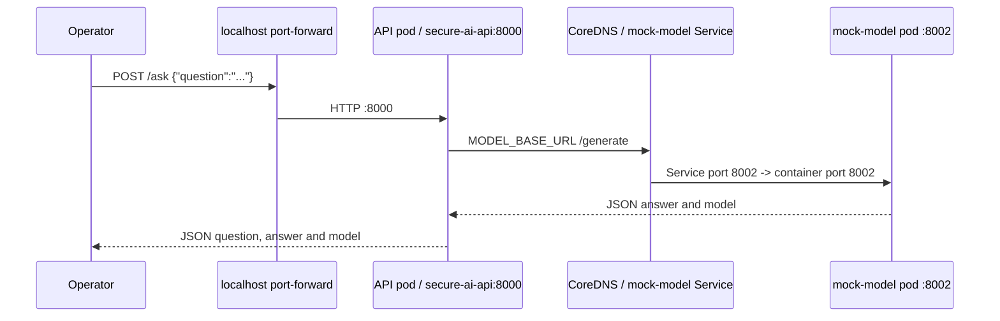

# EKS application deployment with Argo CD

This runbook deploys the existing FastAPI API and mock-model to the verified
`ai-platform-dev` EKS cluster. Argo CD reads the public Git repository and
performs a **manual** sync. It does not create AWS infrastructure, publish
images, expose public endpoints, or install monitoring, GPU, Karpenter or
Airflow workloads.

For Argo CD installation, administrator password handling and upgrades, see
the [Argo CD bootstrap guide](argocd-bootstrap.md).

## Verified prerequisites and current release inputs

Verified on 9 October 2026:

| Item | Verified value |
|---|---|
| AWS account / Region | `429496640190` / `eu-central-1` |
| EKS cluster | `ai-platform-dev`, Kubernetes `1.35.8` |
| Active kubectl context | `arn:aws:eks:eu-central-1:429496640190:cluster/ai-platform-dev` |
| Worker | One Ready Linux `amd64` `t3.medium` node |
| Cluster add-ons | VPC CNI, CoreDNS, kube-proxy and Pod Identity Agent healthy |
| Git repository | Public `https://github.com/Ikteaja/aws-ai-infrastructure-platform.git` |
| Argo CD source branch | `feature/dev-network` |
| Dev namespace | `healthops-dev`, declared and owned by the Argo CD Application |

Before any Kubernetes mutation, confirm the exact active context:

```powershell
kubectl config current-context
```

Expected:

```text
arn:aws:eks:eu-central-1:429496640190:cluster/ai-platform-dev
```

The current Application pins the two immutable ECR image digests built by the
main-branch application CI for commit `e81c5bf0ee84ae14e3e5e60e0499ab7de25a8a23`:

| Deployment | ECR image pinned in dev overlay |
|---|---|
| `secure-ai-api` | `429496640190.dkr.ecr.eu-central-1.amazonaws.com/healthops-dev/api@sha256:3afa88863aa9ad5f90b5675b55fc2c254f692998b14f20374ddfad98c0fbd147` |
| `mock-model` | `429496640190.dkr.ecr.eu-central-1.amazonaws.com/healthops-dev/mock-model@sha256:496f154a558970ff59338494fc75b4ccf181ab9e5f936713999a96e823f6febb` |

ECR reports Docker schema-2 manifests for these images. Application CI builds
on `ubuntu-24.04` and uses a default x86_64 Docker build; the EKS node reports
`amd64`. The EKS worker role pulls from ECR. Do not add a Kubernetes
`imagePullSecret`, AWS access key or image-publisher credential.

## Repository layout and ownership

| Path | Purpose / owner |
|---|---|
| `kubernetes/bootstrap/argocd/` | Helm values and context-guarded PowerShell install script; Helm owns Argo CD release `argocd`. |
| `kubernetes/applications/base/api/` | Shared API Deployment and internal ClusterIP Service. |
| `kubernetes/applications/base/mock-model/` | Shared model Deployment and internal ClusterIP Service. |
| `kubernetes/applications/overlays/local/` | Local namespace, image tags, local model DNS name and the existing two API replicas. Apply locally with Kustomize. |
| `kubernetes/applications/overlays/dev/` | Dev namespace, generated non-secret ConfigMap and digest-pinned ECR images. The `healthops-dev` Argo CD Application owns all resources in this overlay, including its Namespace. |
| `kubernetes/argocd/projects/` | Explicitly bootstrapped AppProject limiting repository, cluster, namespace and resource kinds. |
| `kubernetes/argocd/applications/` | Explicitly bootstrapped Argo CD Application; no automated sync, prune or self-heal. |

Terraform owns the AWS VPC, EKS cluster, node group and node IAM/ECR pull
permissions. Helm owns only Argo CD. The operator initially creates the
AppProject and Application with `kubectl apply`; Argo CD owns the application
Namespace, ConfigMap, Deployments and Services after its first manual sync.
Do not also apply these dev application resources with `kubectl`, Terraform or
another controller.

The local overlay remains available and keeps the prior local image tags and
two API replicas:

```powershell
kubectl kustomize .\kubernetes\applications\overlays\local
kubectl apply -k .\kubernetes\applications\overlays\local
kubectl rollout status deployment/secure-ai-api -n ai-platform --timeout=5m
kubectl rollout status deployment/mock-model -n ai-platform --timeout=5m
```

Run those commands only against the intended local Kubernetes context. Never
use the local overlay against EKS.

## Application contract and resource mapping

The API container runs
`python -m uvicorn app.src.main:app --host 0.0.0.0 --port 8000`; the model
container runs
`python -m uvicorn model_service.main:app --host 0.0.0.0 --port 8002`.
`POST /ask` accepts JSON `{"question":"..."}` (non-empty text, up to 1,000
characters). The API forwards `{"prompt":"..."}` to the model's `/generate`
endpoint and returns `question`, `answer` and `model`.

| Workload | Replica(s) / image | Pod label → Service selector | Container port → Service port / targetPort | Probe endpoints | Resources per pod | Workload AWS identity |
|---|---|---|---|---|---|---|
| Deployment `secure-ai-api` | 1; `api@sha256:3afa88863aa9ad5f90b5675b55fc2c254f692998b14f20374ddfad98c0fbd147` | `app=secure-ai-api` → `app=secure-ai-api` | `8000/TCP` → `8000` / named target `http` (container `8000`) | Startup and liveness `/health`; readiness `/ready` | requests `100m` CPU, `128Mi`; limits `500m`, `512Mi` | None; token automount disabled |
| Deployment `mock-model` | 1; `mock-model@sha256:496f154a558970ff59338494fc75b4ccf181ab9e5f936713999a96e823f6febb` | `app=mock-model` → `app=mock-model` | `8002/TCP` → `8002` / named target `http` (container `8002`) | Startup, liveness and readiness `/health` | requests `100m` CPU, `128Mi`; limits `500m`, `512Mi` | None; token automount disabled |

The API's non-secret `MODEL_BASE_URL` is generated into a ConfigMap as
`http://mock-model.healthops-dev.svc.cluster.local:8002`. Kubernetes Service
DNS resolves it to the model Service ClusterIP; the Service selects pods with
`app=mock-model` and forwards port `8002` to the named container port `http`.
The API readiness endpoint currently checks only the API process and does not
prove the model is reachable; the `/ask` test below exercises the actual call.
Both images run as UID/GID `10001`, disallow privilege escalation, drop Linux
capabilities, use `RuntimeDefault` seccomp and a read-only root filesystem.

## Delivery and manual deployment model

```mermaid
flowchart LR
    Code["Application code"] --> Push["Reviewed Git change"]
    Push --> CI["GitHub Actions: tests, build and vulnerability scans"]
    CI --> ECR["ECR: immutable commit-tagged images"]
    ECR --> Manifest["Reviewed dev overlay digest update"]
    Manifest --> Git["Push GitOps change to tracked branch"]
    Git --> Argo["Argo CD reads Git"]
    Argo --> Diff["Operator reviews rendered diff"]
    Diff -->|manual sync only| EKS["Existing EKS: healthops-dev"]
```





GitHub Actions tests, scans and builds application images. The main-branch
publisher job uses its dedicated OIDC role to publish tested images to ECR
when the `ECR_PUBLISHER_ROLE_ARN` repository variable is configured. Publishing
an image or changing application code **does not itself deploy it**. To
release code, update the dev overlay to the newly verified ECR digest, review
and push that manifest change to the tracked branch, inspect the Argo CD diff,
then manually sync.

## Validate manifests and bootstrap Argo CD

From the repository root, render both overlays before making cluster changes:

```powershell
kubectl kustomize .\kubernetes\applications\overlays\local
kubectl kustomize .\kubernetes\applications\overlays\dev
```

Confirm the dev output contains exactly one replica per Deployment, namespace
`healthops-dev`, the two `@sha256:` ECR references above, ClusterIP Services,
and the ConfigMap URL. Verify there are no credentials in the manifests.
Validate the pinned official Helm chart and its values:

```powershell
helm lint argo/argo-cd --version 10.10.2 `
  --values .\kubernetes\bootstrap\argocd\values.yaml
helm template argocd argo/argo-cd --namespace argocd `
  --version 10.10.2 `
  --values .\kubernetes\bootstrap\argocd\values.yaml
```

Recheck `kubectl config current-context`, nodes and allocated resources using
the bootstrap guide. Then install and check Argo CD:

```powershell
.\kubernetes\bootstrap\argocd\install.ps1
helm status argocd -n argocd
kubectl get pods -n argocd -o wide
kubectl get service argocd-server -n argocd
```

Expected: core Argo CD pods Ready, the server Service is `ClusterIP`, and no
Ingress or LoadBalancer exists. The chart is single-replica/non-HA.

Keep the local port-forward open in one PowerShell window and open the UI:

```powershell
kubectl port-forward -n argocd service/argocd-server 8080:80
```

Retrieve the generated administrator password and rotate it using the
instructions in the [bootstrap guide](argocd-bootstrap.md#open-the-ui-locally-and-rotate-the-password).
Do not copy it into Git or CI logs.

The repository is public and requires no credential. Confirm the current
branch is pushed and readable before bootstrapping the project and Application:

```powershell
git branch --show-current
git ls-remote https://github.com/Ikteaja/aws-ai-infrastructure-platform.git `
  refs/heads/feature/dev-network
```

The result must include `feature/dev-network`. After checking context again,
server-side dry-run the Argo CRs (the Helm chart must have installed their
CRDs), then create the AppProject followed by the Application:

```powershell
kubectl config current-context
kubectl apply --dry-run=server -f .\kubernetes\argocd\projects\healthops-dev.yaml
kubectl apply --dry-run=server -f .\kubernetes\argocd\applications\healthops-dev.yaml
kubectl apply -f .\kubernetes\argocd\projects\healthops-dev.yaml
kubectl apply -f .\kubernetes\argocd\applications\healthops-dev.yaml
```

The AppProject allows the single public repository, local EKS API destination,
namespace `healthops-dev`, and only Namespace, ConfigMap, Service and
Deployment resource kinds. The Application does not enable automated sync,
automated pruning or self-healing. Wait for Argo to fetch and render its
source, verify it has no repository or manifest-generation error, and review
the complete UI diff. CLI equivalents (requires Argo CD CLI and local
port-forward/authentication):

```powershell
argocd app get healthops-dev
argocd app diff healthops-dev
```

Only after reviewing the diff, click **Sync** in the UI, or explicitly run:

```powershell
argocd app sync healthops-dev
argocd app wait healthops-dev --sync --health --timeout 300
```

The expected initial diff contains the `healthops-dev` Namespace, generated
ConfigMap, two Deployments and two ClusterIP Services. Review any unexpected
resource or image before syncing. The namespace object is part of the overlay,
so `CreateNamespace` is disabled and no other tool should manage that namespace.

Kustomize rendering, Helm rendering and server-side dry-run of the namespace
and Argo CRs are safe preflight checks. A server-side dry-run of all app
resources is not appropriate before the Application creates its destination
namespace; Argo's pre-sync diff is the validation of the actual source against
the cluster before the manual sync.

## Verify deployment and service communication

After manual sync, run these checks:

```powershell
kubectl get application healthops-dev -n argocd
kubectl get namespace healthops-dev
kubectl get deployments,services -n healthops-dev -o wide
kubectl rollout status deployment/secure-ai-api -n healthops-dev --timeout=5m
kubectl rollout status deployment/mock-model -n healthops-dev --timeout=5m
kubectl get pods -n healthops-dev -o wide
kubectl get endpointslices -n healthops-dev `
  -l kubernetes.io/service-name=secure-ai-api -o wide
kubectl get endpointslices -n healthops-dev `
  -l kubernetes.io/service-name=mock-model -o wide
kubectl get events -n healthops-dev --sort-by=.lastTimestamp
```

Both Deployments should show `1/1` available, each Pod should be Ready, and
each EndpointSlice should contain the corresponding Ready pod address. Check
the running image references and runtime image IDs without printing secrets:

```powershell
kubectl get pods -n healthops-dev `
  -o "custom-columns=POD:.metadata.name,IMAGE:.spec.containers[*].image,IMAGE-ID:.status.containerStatuses[*].imageID,NODE:.spec.nodeName"
```

The requested image is pinned by digest, and `imageID` should report the
runtime's corresponding `sha256` digest. The node should be the cluster's
`amd64` EKS worker. Check logs if either rollout or probe fails:

```powershell
kubectl logs -n healthops-dev deployment/secure-ai-api --all-pods=true
kubectl logs -n healthops-dev deployment/mock-model --all-pods=true
kubectl describe pods -n healthops-dev
```

Open a localhost-only port-forward to the API Service:

```powershell
kubectl port-forward -n healthops-dev service/secure-ai-api 8080:8000
```

In another PowerShell window, verify the probes and exercise the actual
`POST /ask` contract:

```powershell
Invoke-RestMethod http://127.0.0.1:8080/health
Invoke-RestMethod http://127.0.0.1:8080/ready
Invoke-RestMethod -Method Post `
  -Uri http://127.0.0.1:8080/ask `
  -ContentType "application/json" `
  -Body (@{ question = "How does the API reach the mock model in EKS?" } | ConvertTo-Json)
```

Expected: `/health` returns `status=healthy`, `/ready` returns `status=ready`,
and `/ask` returns HTTP 200 with the submitted question, a
`Mock response: received your prompt ...` answer and `model=mock-model-v1`.
This request verifies the API's ConfigMap setting, CoreDNS service name,
Service selector/endpoints, model `/generate` path, and response contract.
Stop both port-forwards with Ctrl+C when finished.

## Image updates and rollback

1. Change application code and let Application CI test, build and scan it.
2. For a main-branch release, verify the publisher workflow succeeded and
   retrieve the immutable digest from ECR or its workflow summary.
3. Change only the matching image `digest` in
   `kubernetes/applications/overlays/dev/kustomization.yaml`; review the
   generated manifests and ECR digest.
4. Commit and push the overlay change to `feature/dev-network` (or update the
   Application target revision in a separately reviewed change).
5. Review the new Argo CD diff. Sync manually only after approval.
6. Verify image IDs, Pod readiness and the `/ask` request again.

Publishing a new image, even with a new Git tag, does not change the manifest
digest and does not deploy it. Roll back by reverting the Git commit that
changed the image digest or configuration, push the revert, review the Argo
CD diff, and manually sync. Do not patch the running Deployment directly;
that creates live drift from the Git source.

## Troubleshooting

| Symptom | Checks |
|---|---|
| Argo repo status is `ComparisonError` | Confirm `feature/dev-network` exists remotely, the URL is exact, and the repository remains public. Check repo-server logs; do not add a credential for a public repo. |
| Kustomize render fails | Run `kubectl kustomize .\kubernetes\applications\overlays\dev`; check paths, YAML indentation, generated ConfigMap references and image digests. |
| Application is `OutOfSync` before first sync | Expected. Review the diff; automated sync is intentionally disabled. |
| Pods are `Pending` | Inspect `kubectl describe pod` and node requested capacity. Do not resize the EC2 node group without explicit infrastructure approval. |
| `ImagePullBackOff` | Verify repository/digest exists, worker role has pull-only permissions, and worker NAT/ECR/S3 connectivity. Do not create ECR login Secrets. |
| API returns 503 from `/ask` | Check the model Pod is Ready, EndpointSlice has a ready address, and `MODEL_BASE_URL` is the fully qualified `mock-model` Service URL. Read API/model logs. |
| API readiness succeeds but `/ask` fails | `/ready` is a process-only check today; troubleshoot the API-to-model request separately. |
| `kubectl` reports forbidden | Confirm the active context/identity and the administrator EKS access entry; do not broaden the application IAM role. |

## Deliberate cleanup

First stop or remove the Argo-managed application resources through Argo CD;
do not use `kubectl delete -k`, Terraform or an alternate controller while
Argo CD owns the dev overlay. Because automated pruning is disabled, removing
objects from Git does not immediately delete live objects.

To remove the complete application, including the overlay-owned Namespace,
explicitly request cascading deletion with the Argo CD CLI:

```powershell
argocd app delete healthops-dev --cascade
```

Review the confirmation in the CLI/UI and verify the `healthops-dev` namespace
and its workloads are gone. A plain Application deletion without cascading
behavior can leave the managed resources behind. Delete the AppProject only
after the Application is gone:

```powershell
kubectl delete -f .\kubernetes\argocd\projects\healthops-dev.yaml
```

Argo CD cleanup is separate from EKS cleanup. Do not uninstall the cluster,
node group, VPC or ECR as part of application removal. If Argo CD itself is to
be removed, follow the Helm release cleanup and CRD-retention cautions in the
[bootstrap guide](argocd-bootstrap.md#upgrade-and-cleanup).
